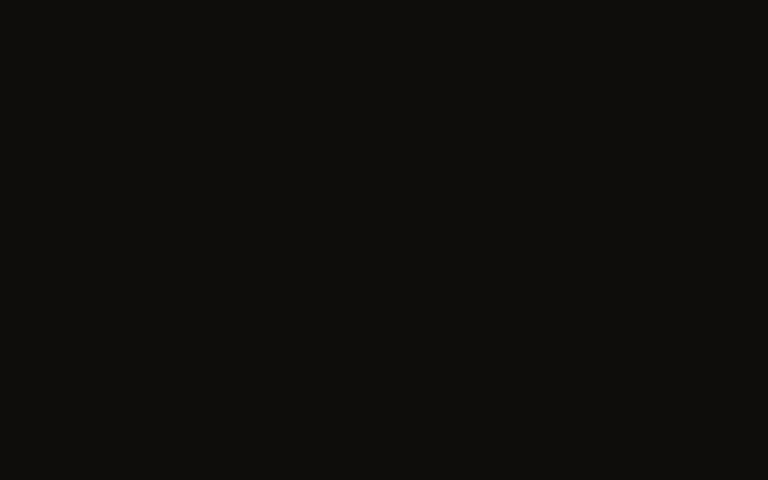

# mathanim

Small self-contained C++ math animations (GLFW + fixed-function OpenGL, no other dependencies).

## Demo



## Build & run

```sh
make            # builds every .cpp in this directory
./golden_ratio
```

## golden_ratio.cpp — animated golden ratio

The classic Fibonacci/golden-spiral construction, looped:

1. A golden rectangle is outlined; φ and its closed form are shown.
2. Squares of Fibonacci size (1, 1, 2, 3, 5, 8, 13, 21, 34, 55, 89) attach
   around a growing golden rectangle — up, right, then cycling up → right →
   down → left — each drawn just before its quarter-arc is swept clockwise.
   Consecutive arcs share a corner and tangent, so the spiral is continuous.
3. A live readout tracks **F(n+1)/F(n)** as each square lands:
   2 → 1.5 → 1.667 → 1.6 → 1.625 → … → 89/55 = 1.618182, converging to φ.
4. The finished spiral is held with a light pulse and a comet travelling the
   spiral path, then the loop fades and repeats.

Keys: `Space` pause · `R` restart · `↑`/`↓` speed · `Esc` quit.

Offscreen frame dump (writes PPM files, no visible window):

```sh
./golden_ratio --dump 19 0.92 /tmp/golden_frames
magick /tmp/golden_frames/f0014.ppm frame.png
```

Notes on the geometry (also commented in the source):

- The spiral is generated by walking a `(point, heading)` state: each arc's
  center is `p + r·rot90cw(heading)` (center right of motion for clockwise
  winding), sweeping −90°, with the new heading the clockwise tangent.
- A square's number label sits at the corner diagonal to that arc's center —
  the one corner the arc never touches — pulled toward the square's center.
- Text is a small built-in stroke font (7-segment digits + a few glyphs), so
  only characters with entries in `initFont()` can be displayed.